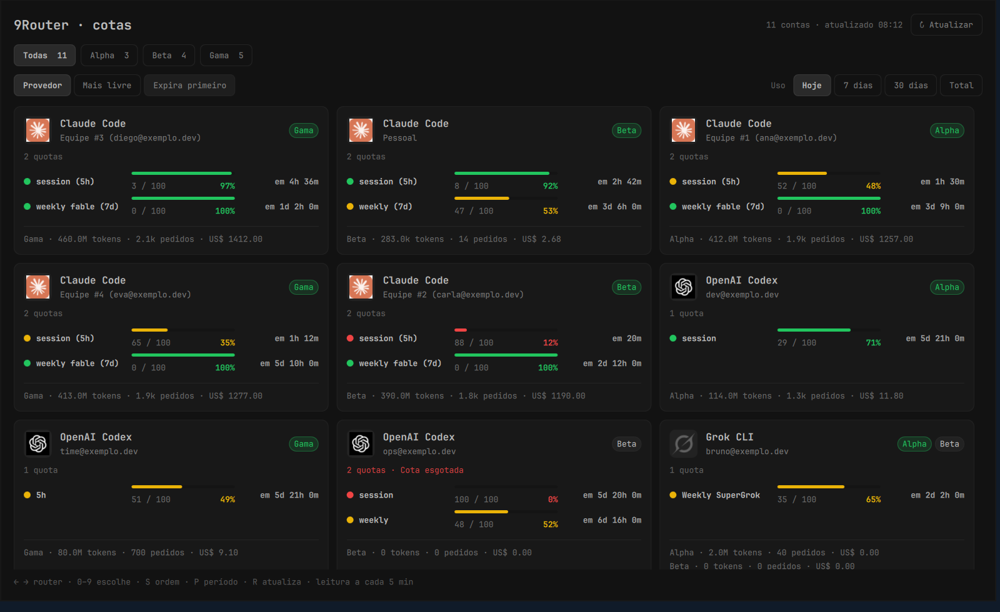

# Radar 9Router

As cotas das contas dos seus 9Routers na barra do Omarchy, no mesmo formato do Quota Tracker do painel do 9Router.

O ícone **9R** abre uma grade de cards, um por conta, com o ícone do provedor e uma barra por cota: verde acima de 70% livre, amarela de 30% a 70%, vermelha abaixo. Cada barra mostra o usado (`52 / 100`), o que resta e quando renova. Os botões do topo mostram todos os routers juntos ou só um deles, e a ordem pode ser por provedor, mais livre ou expira primeiro.



## Instalar

Requer Omarchy com Quickshell e plugins, Python 3 e systemd do usuário. SSH e Docker são necessários apenas pra routers com transporte SSH. Node.js é necessário pra rodar os testes do modelo.

```bash
git clone https://github.com/LucasOl1337/omarchy-9router-radar.git
cd omarchy-9router-radar
mkdir -p ~/.config/omarchy-9router-radar
cp routers.example.json ~/.config/omarchy-9router-radar/routers.json
# Edite o arquivo com seus routers e a forma de obter a senha do painel.
python3 install.py
```

Você pode cadastrar qualquer quantidade de routers. Com `transport: "http"`, informe `base_url` e `password_command`: uma lista de argumentos que retorna a senha do painel pela saída padrão. O exemplo usa o chaveiro `secret-tool`. Como alternativa, `password_env` indica uma variável disponível ao serviço systemd. A senha fica fora do JSON de configuração.

Com `transport: "ssh"`, informe `ssh_host`, `container` e `api_port`. O coletor lê o painel dentro do container por autenticação CLI local do 9Router. O servidor precisa aceitar SSH sem interação, ter Node no container e os arquivos de autenticação em `/app/data`.

O cadastro legado em `~/.config/rotas/routers.json` continua funcionando quando o cadastro novo não existe. Nesse modo, Railway e Sherlocker usam os comandos do cofre local, e Hostinger usa o alias SSH `sennin-kvm`.

O radar junta o mesmo email e provedor entre routers. Contas com nomes genéricos ficam separadas porque o nome sozinho não confirma identidade. Desativadas e removidas continuam no fim pra consultar o histórico.

A ordem considera a cota semanal geral, quando existe; caso contrário, usa a sessão ou a janela informada pelo provedor. Uma sessão esgotada bloqueia a recomendação mesmo com semana disponível. Limites específicos de um modelo não substituem a semana geral. Contas sem cota, com leitura de mais de 20 minutos, reset passado ou erro de atualização ficam sem recomendação. Isso indica disponibilidade de cota; a escolha do modelo depende da tarefa.

Cada linha mostra os tokens, pedidos e custo estimado registrados por cada router. Um pedido encaminhado entre routers pode aparecer nos dois, então o painel mantém esses registros separados.

## Arquivos e operação

- Fonte: diretório do clone deste repositório.
- Plugin ativo: `~/.config/omarchy/plugins/lol.routers/`.
- Cadastro de gateways: `~/.config/omarchy-9router-radar/routers.json`, com fallback pro cadastro legado.
- Estado: `~/.local/state/omarchy-trackers/routers/status.json`, modo 0600.
- Timer: `omarchy-routers.timer`, leitura a cada cinco minutos depois da coleta anterior.

```bash
python3 install.py
systemctl --user status omarchy-routers.timer
systemctl --user start omarchy-routers.service
node --test tests/test_radar.cjs
python3 -m unittest discover -s tests -v
```

O instalador publica a interface em `.runtime/<hash>/` e troca o manifesto depois de copiar todos os imports. Isso evita que a barra mantenha QML antigo em cache durante uma atualização.

O arquivo de estado guarda apenas os campos de conta, uso e cota selecionados pelo coletor. Não grava senhas, tokens ou cookies. A coleta não envia prompts e não troca a configuração das rotas. A API de cota pode renovar a autenticação do provedor no próprio gateway.

Clique no ícone pra abrir; botão do meio ou R atualizam e Esc fecha. Setas ← → trocam de router, 0 a 9 escolhem direto (0 é Todas), ↑ ↓ rolam, S troca a ordem e P o período. Hoje, 7 dias, 30 dias e Total mudam os números de uso no rodapé de cada card; a cota segue sempre a janela atual do provedor. Router, ordem e período ficam lembrados em `~/.local/state/omarchy-trackers/routers/view.json`.

Em Todas, a mesma conta presente em mais de um router vira um card só, com um selo por router; o selo verde é a rota recomendada. Contas desativadas aparecem apagadas no fim, e as removidas ficam ocultas. Os ícones dos provedores vêm do [9Router](https://github.com/decolua/9router) (MIT).

Pra conferir o que a barra carregou:

```bash
quickshell ipc -p /usr/share/omarchy/shell call lol.routers diagnostics
```

Licença MIT. As leituras dependem das APIs de painel do 9Router e da disponibilidade de cota em cada provedor. Sem leitura recente, a conta fica sem recomendação.
